# Spesifikasi ERD Database Siaga Padang (`ranah_siaga_v4.db`)

Dokumen ini menjelaskan struktur basis data lokal Android Siaga Padang versi 4: tabel, primary key, dan keterkaitan logis antartabel. Database dibangun oleh [`build_db.py`](../build_db.py) dari data BPBD (lihat [build_db_v4.md](build_db_v4.md)).

- **DBML lengkap** (impor ke dbdiagram.io): [`siaga_padang_erd.dbml`](siaga_padang_erd.dbml). Berkas ini dibangkitkan otomatis oleh [`generate_dbml_file.py`](../generate_dbml_file.py) dari DB, jadi jalankan ulang generator setiap skema berubah.
- Semua relasi adalah **keterkaitan logis** yang dipakai aplikasi, bukan *foreign key constraint* SQLite.
- 12 tabel inti dan 1 view memiliki skema yang sama dengan v3 (dipakai Room di Android), ditambah kolom `tb_safe_routes.safe_zone_id` yang dipakai aplikasi sejak dataset 2026.09.28. 6 tabel lainnya baru di v4 dan bersifat opsional.

---

> **Gambar 5.3 Struktur logis basis data lokal pada perangkat Android**
>
> Basis data terdiri atas lapisan graf jalan, rute prakomputasi ke tiga jenis tujuan (TES vertikal, TEA horizontal, dan zona aman terdekat), zona spasial untuk menentukan posisi pengguna, serta tabel penugasan berbasis kapasitas. Garis putus-putus menunjukkan keterkaitan logis yang digunakan aplikasi.

---

## Tabel inti (skema sama dengan v3)

| Tabel | Primary key | Isi | Relasi logis |
|---|---|---|---|
| `tb_nodes` | `node_id` | Simpul jalan (lat, lon). `is_safe`: 0 = zona merah (area landaan raster KRB), 1 = zona aman | – |
| `tb_edges` | `edge_id` | Ruas jalan: `u`, `v`, `length` (m), `geometry` (WKT LineString) | `u`, `v` → `tb_nodes.node_id` |
| `tb_tes` | `tes_id` (`TES_001`…) | TES yang dipakai routing: nama, `zona` (kelurahan), kapasitas (jiwa), lat, lon | – |
| `tb_routes` | `origin_node_id` | 3 TES terbaik per node **zona merah**: `rank_X_tes` (nama), `rank_X_path` (ID node dipisah koma), `rank_X_eta` (menit) | `origin_node_id` → `tb_nodes` (1:1); `rank_X_tes` → `tb_tes.nama_tes` |
| `tb_tea` | `tea_id` (`TEA_001`…) | TEA di luar area landaan: nama, kelurahan, kecamatan (`sektor`), kapasitas (0 = tidak tersedia), lat, lon | `nearest_node_id` → `tb_nodes` |
| `tb_tea_routes` | `origin_node_id` | TEA utama & alternatif per node | → `tb_nodes` (1:1); `nearest_tea_id`, `alt_tea_id` → `tb_tea` |
| `tb_tea_next` | (`tea_id`, `node_id`) | Node berikutnya menuju tiap TEA | `tea_id` → `tb_tea`; `node_id`, `next_node_id` → `tb_nodes` |
| `tb_safe_routes` | `origin_node_id` | **Lama, hanya kompatibilitas.** Zona aman terdekat per node dari satu pohon global: `safe_node_id`, nama, `safe_eta` (menit). Tidak menjamin aturan pantai; aplikasi baru memakai `tb_safe_routes_v2` | → `tb_nodes` (1:1) |
| `tb_safe_next` | (`node_id`, `next_node_id`) | **Lama, hanya kompatibilitas.** Node berikutnya menuju zona aman terdekat | → `tb_nodes` |
| `tb_inundation_zones` | `zone_id` | Poligon zona merah per kelurahan. `tingkat_bahaya` selalu `Tinggi` | Pemeriksaan spasial |
| `tb_safe_zones` | `safe_zone_id` | Poligon zona hijau per kelurahan. `elevasi_m` NULL | Pemeriksaan spasial |
| `tb_route_shares` | – | Porsi penugasan warga per node: `jenis` (TES/TEA/ZONA_AMAN), `nama_tujuan`, `porsi` | `origin_node_id` → `tb_nodes` |
| `v_fasilitas_evakuasi` (view) | – | Gabungan `tb_tes` + `tb_tea` (`jenis`, `tipe_evakuasi`) | – |

## Tabel tambahan v4

| Tabel | Primary key | Isi |
|---|---|---|
| `tb_safe_routes_v2` | `origin_node_id` | Zona aman per node **zona merah** yang patuh aturan pantai: `kelompok` (floor jarak pantai / 100 m), `safe_node_id`, nama, `safe_eta`, `safe_d_pantai_m`, `mendekat_pantai_maks_m` |
| `tb_safe_next_v2` | (`kelompok`, `node_id`) | Next-hop menuju zona aman per kelompok jarak pantai; dirangkai seperti `tb_tea_next` |
| `tb_fasilitas_info` | `facility_id` | Semua TES/TEA sumber BPBD, termasuk yang tidak dipakai: `dipakai`, `alasan_tidak_dipakai`, `kapasitas_sumber`, `d_pantai_m`, `indeks_bahaya`, lantai & kapasitas 2019, luas jejak bangunan |
| `tb_node_info` | `node_id` | Kelurahan, `d_pantai_m`, `indeks_bahaya`, `demand_jiwa`, flag rute TES/zona aman lewat jembatan sungai, `kantong_aman`, `rute_tes_mendekat_pantai_m`, `rute_aman_mendekat_pantai_m` |
| `tb_kelurahan_info` | – (`kelurahan` unik) | Profil tsunami 56 kelurahan dari tabel KRB: luas bahaya, jiwa terpapar, umur rentan, miskin, disabilitas, indeks kesiapsiagaan/kapasitas/risiko, `jiwa_rute_aman_mendekat_pantai`, `jiwa_tanpa_rute_aman` |
| `tb_jembatan_sungai` | (`u`, `v`) | Ruas jembatan sungai: panjang, indeks bahaya gempa |
| `tb_jalur_resmi` | (`u`, `v`) | Ruas graf yang mengikuti jalur evakuasi resmi BPBD |
| `tb_metadata` | `kunci` | Versi, sumber data, parameter build |

Daftar kolom lengkap ada di berkas DBML.

---

## Diagram relasi (Mermaid)

```mermaid
erDiagram
    tb_nodes ||..o{ tb_edges : "u, v"
    tb_nodes ||..o| tb_routes : "origin_node_id"
    tb_tes ||..o{ tb_routes : "rank_1..3_tes (nama)"
    tb_nodes ||..o| tb_tea_routes : "origin_node_id"
    tb_tea ||..o{ tb_tea_routes : "nearest / alt"
    tb_tea ||..o{ tb_tea_next : "tea_id"
    tb_nodes ||..o{ tb_tea_next : "node_id, next_node_id"
    tb_nodes ||..o| tb_safe_routes : "origin_node_id"
    tb_nodes ||..o{ tb_safe_next : "node_id, next_node_id"
    tb_nodes ||..o| tb_safe_routes_v2 : "origin_node_id"
    tb_nodes ||..o{ tb_safe_next_v2 : "node_id, next_node_id"
    tb_safe_routes_v2 }o..o{ tb_safe_next_v2 : "kelompok"
    tb_nodes ||..o{ tb_route_shares : "origin_node_id"
    tb_nodes ||..|| tb_node_info : "node_id"
    tb_nodes ||..o{ tb_fasilitas_info : "nearest_node_id"
    tb_nodes ||..o{ tb_jembatan_sungai : "u, v"
    tb_nodes ||..o{ tb_jalur_resmi : "u, v"

    tb_nodes {
        INTEGER node_id PK
        REAL lat
        REAL lon
        INTEGER is_safe "0 zona merah, 1 aman"
    }
    tb_edges {
        INTEGER edge_id PK
        INTEGER u
        INTEGER v
        REAL length "meter"
        TEXT geometry "WKT"
    }
    tb_tes {
        TEXT tes_id PK
        TEXT nama_tes
        TEXT zona "kelurahan"
        REAL kapasitas
        REAL lat
        REAL lon
    }
    tb_routes {
        INTEGER origin_node_id PK
        TEXT rank_1_tes
        TEXT rank_1_path
        REAL rank_1_eta
        TEXT rank_2_tes
        TEXT rank_2_path
        REAL rank_2_eta
        TEXT rank_3_tes
        TEXT rank_3_path
        REAL rank_3_eta
    }
    tb_tea {
        TEXT tea_id PK
        TEXT nama_tea
        TEXT kelurahan
        REAL kapasitas
        INTEGER nearest_node_id
    }
    tb_tea_routes {
        INTEGER origin_node_id PK
        TEXT nearest_tea_id
        TEXT alt_tea_id
    }
    tb_tea_next {
        TEXT tea_id PK
        INTEGER node_id PK
        INTEGER next_node_id
    }
    tb_safe_routes {
        INTEGER origin_node_id PK
        INTEGER safe_node_id
        TEXT safe_zone_nama
        REAL safe_eta
        INTEGER safe_zone_id
    }
    tb_safe_next {
        INTEGER node_id PK
        INTEGER next_node_id PK
    }
    tb_safe_routes_v2 {
        INTEGER origin_node_id PK
        INTEGER kelompok
        INTEGER safe_node_id
        REAL safe_eta
        REAL mendekat_pantai_maks_m
        INTEGER safe_zone_id
    }
    tb_safe_next_v2 {
        INTEGER kelompok PK
        INTEGER node_id PK
        INTEGER next_node_id
    }
    tb_route_shares {
        INTEGER origin_node_id
        TEXT jenis
        TEXT nama_tujuan
        REAL porsi
    }
    tb_node_info {
        INTEGER node_id PK
        TEXT kelurahan
        REAL d_pantai_m
        REAL demand_jiwa
        INTEGER kantong_aman
        REAL rute_aman_mendekat_pantai_m
    }
    tb_fasilitas_info {
        TEXT facility_id PK
        TEXT jenis
        INTEGER dipakai
        TEXT kapasitas_sumber
    }
    tb_jembatan_sungai {
        INTEGER u PK
        INTEGER v PK
        REAL indeks_bahaya_gempa
    }
    tb_jalur_resmi {
        INTEGER u PK
        INTEGER v PK
    }
    tb_inundation_zones {
        INTEGER zone_id PK
        TEXT nama_zona
        TEXT tingkat_bahaya
        TEXT geometry_wkt
    }
    tb_safe_zones {
        INTEGER safe_zone_id PK
        TEXT nama_zona
        REAL elevasi_m
        TEXT geometry_wkt
    }
    tb_kelurahan_info {
        TEXT kelurahan
        REAL jiwa_terpapar
        REAL jiwa_umur_rentan
        TEXT kelas_risiko
    }
```

