# Spesifikasi Detail ERD Database Siaga Padang (`ranah_siaga.db`)

Dokumen ini berisi **spesifikasi detail struktur ERD (Entity Relationship Diagram)** untuk basis data **Siaga Padang** (`ranah_siaga.db`), yang mencakup letak **Primary Key (PK)**, keterkaitan logis antartabel, serta tipe data SQLite yang digunakan.

---

> **Gambar 5.3 Struktur logis basis data lokal pada perangkat Android**
> 
> Gambar 5.3 memperlihatkan enam tabel utama pada basis data lokal. Garis putus-putus menunjukkan keterkaitan logis yang digunakan aplikasi, bukan *foreign key constraint* pada SQLite. Tabel `tb_routes` menghubungkan simpul asal dengan tiga peringkat tujuan dan lintasan prakomputasi, sedangkan tabel zona digunakan untuk menentukan posisi pengguna melalui pemeriksaan spasial.

---

## 📌 Rincian Letak Primary Key (PK) & Keterkaitan Logis Antartabel

| Nama Tabel | Kolom / Field | Tipe Data SQLite | Peran (Key) | Referensi Relasi Logis (Target) | Kardinalitas | Penjelasan / Fungsi |
| :--- | :--- | :---: | :---: | :--- | :---: | :--- |
| **`tb_nodes`** | `node_id` | `INTEGER` | **Primary Key** | - | 1 | ID Unik simpul persimpangan jalan di Kota Padang. |
| | `lat` | `REAL` | - | - | - | Koordinat Lintang (Latitude WGS84). |
| | `lon` | `REAL` | - | - | - | Koordinat Bujur (Longitude WGS84). |
| | `is_safe` | `INTEGER` | - | - | - | Flag Status Zona (0 = Rawan, 1 = Tanda simpul di kawasan aman). |
| **`tb_edges`** | `edge_id` | `INTEGER` | **Primary Key** | - | 1 | ID Unik ruas jalan penghubung. |
| | `u` | `INTEGER` | **Relasi Logis** | ➔ `tb_nodes.node_id` | N : 1 | Simpul persimpangan asal ruas jalan. |
| | `v` | `INTEGER` | **Relasi Logis** | ➔ `tb_nodes.node_id` | N : 1 | Simpul persimpangan tujuan ruas jalan. |
| | `length` | `REAL` | - | - | - | Panjang ruas jalan faktual (dalam meter). |
| | `geometry` | `TEXT` | - | - | - | Geometri spasial garis jalan (LineString WKT). |
| **`tb_tes`** | `tes_id` | `TEXT` | **Primary Key** | - | 1 | Kode unik TES (misal: `TES_001`). |
| | `nama_tes` | `TEXT` | - | Target Relasi Logis | 1 | Nama resmi TES (target rujukan `tb_routes`). |
| | `zona` | `TEXT` | - | - | - | Nama kelurahan / kecamatan lokasi TES. |
| | `kapasitas` | `REAL` | - | - | - | Kapasitas daya tampung TES (satuan: jiwa). |
| | `lat` | `REAL` | - | - | - | Koordinat Lintang lokasi TES. |
| | `lon` | `REAL` | - | - | - | Koordinat Bujur lokasi TES. |
| **`tb_routes`** | `origin_node_id` | `INTEGER` | **PK & Relasi Logis** | ➔ `tb_nodes.node_id` | 1 : 1 | Node persimpangan posisi awal warga evakuasi. |
| | `rank_1_tes` | `TEXT` | **Relasi Logis** | ➔ `tb_tes.nama_tes` | N : 1 | Nama TES rekomendasi pilihan ke-1. |
| | `rank_1_path` | `TEXT` | - | - | - | Deretan ID simpul rute ke-1 (teks list node, tanpa FK langsung). |
| | `rank_1_eta` | `REAL` | - | - | - | Estimasi waktu tempuh / ETA rute ke-1 (dalam menit). |
| | `rank_2_tes` | `TEXT` | **Relasi Logis** | ➔ `tb_tes.nama_tes` | N : 1 | Nama TES rekomendasi pilihan ke-2. |
| | `rank_2_path` | `TEXT` | - | - | - | Deretan ID simpul rute ke-2 (teks list node, tanpa FK langsung). |
| | `rank_2_eta` | `REAL` | - | - | - | Estimasi waktu tempuh / ETA rute ke-2 (dalam menit). |
| | `rank_3_tes` | `TEXT` | **Relasi Logis** | ➔ `tb_tes.nama_tes` | N : 1 | Nama TES rekomendasi pilihan ke-3. |
| | `rank_3_path` | `TEXT` | - | - | - | Deretan ID simpul rute ke-3 (teks list node, tanpa FK langsung). |
| | `rank_3_eta` | `REAL` | - | - | - | Estimasi waktu tempuh / ETA rute ke-3 (dalam menit). |
| **`tb_inundation_zones`**| `zone_id` | `INTEGER` | **Primary Key** | - | 1 | ID Unik poligon zona rendaman tsunami. |
| | `nama_zona` | `TEXT` | - | - | - | Nama kelurahan / kawasan pesisir rawan. |
| | `tingkat_bahaya` | `TEXT` | - | - | - | Kategori tingkat bahaya tsunami. |
| | `geometry_wkt` | `TEXT` | - | Spatial Check | - | Geometri poligon spasial rendaman (WKT MultiPolygon). |
| **`tb_safe_zones`** | `safe_zone_id` | `INTEGER` | **Primary Key** | - | 1 | ID Unik poligon zona aman perbukitan (TEA). |
| | `nama_zona` | `TEXT` | - | - | - | Nama kawasan perbukitan. |
| | `elevasi_m` | `REAL` | - | - | - | Ketinggian elevasi dari permukaan laut (dalam meter). |
| | `geometry_wkt` | `TEXT` | - | Spatial Check | - | Geometri poligon spasial zona aman (WKT MultiPolygon). |
| **`tb_tea`** | `tea_id` | `TEXT` | **Primary Key** | - | 1 | Kode unik TEA. |
| | `kapasitas` | `REAL` | - | - | - | Kapasitas daya tampung TEA (tak terbatas). |
| | `lat` | `REAL` | - | - | - | Koordinat Lintang TEA. |
| | `lon` | `REAL` | - | - | - | Koordinat Bujur TEA. |
| **`tb_tea_routes`** | `origin_node_id` | `INTEGER` | **PK & Relasi Logis** | ➔ `tb_nodes.node_id` | 1 : 1 | Node persimpangan asal rute menuju TEA. |
| | `nearest_tea_id` | `TEXT` | **Relasi Logis** | ➔ `tb_tea.tea_id` | N : 1 | ID TEA terdekat (utama). |
| | `alt_tea_id` | `TEXT` | **Relasi Logis** | ➔ `tb_tea.tea_id` | N : 1 | ID TEA alternatif. |
| **`tb_tea_next`** | `tea_id` | `TEXT` | **PK & Relasi Logis** | ➔ `tb_tea.tea_id` | N : 1 | ID TEA tujuan akhir. |
| | `node_id` | `INTEGER` | **PK & Relasi Logis** | ➔ `tb_nodes.node_id` | N : 1 | Node posisi saat ini. |
| | `next_node_id` | `INTEGER` | **Relasi Logis** | ➔ `tb_nodes.node_id` | N : 1 | Node langkah selanjutnya untuk mencapai TEA. |

---

## 📄 Kode DBML Detail (Copy-Paste ke `dbdiagram.io`)

```dbml
// DBML Schema Definition for dbdiagram.io
// Database: ranah_siaga.db (Sistem Routing Evakuasi Tsunami Kota Padang)

Project SiagaPadangERD {
  database_type: 'SQLite'
  Note: '''
    # STRUKTUR LOGIS DATABASE SIAGA PADANG (ranah_siaga.db)
    Struktur Basis Data Lokal Pada Perangkat Android.
    Garis putus-putus menunjukkan keterkaitan logis yang digunakan aplikasi, bukan foreign key constraint pada SQLite.
  '''
}

// ============================================================================
// 1. KELOMPOK GRAF & SPASIAL JALAN (NETWORK GRAPH)
// ============================================================================

Table tb_nodes {
  node_id INTEGER [pk, increment, note: "PRIMARY KEY: ID Unik Simpul Persimpangan Jalan"]
  lat REAL [note: "Koordinat Lintang (Latitude WGS84)"]
  lon REAL [note: "Koordinat Bujur (Longitude WGS84)"]
  is_safe INTEGER [default: 0, note: "Flag Status Zona (0 = Rawan Tsunami, 1 = Tanda simpul di kawasan aman)"]

  

  Note: "Master data simpul persimpangan jalan & titik rujukan awal evakuasi warga."
}

Table tb_edges {
  edge_id INTEGER [pk, increment, note: "PRIMARY KEY: ID Unik Ruas Jalan"]
  u INTEGER [ref: > tb_nodes.node_id, note: "Keterkaitan Logis -> tb_nodes.node_id (Simpul Asal Persimpangan)"]
  v INTEGER [ref: > tb_nodes.node_id, note: "Keterkaitan Logis -> tb_nodes.node_id (Simpul Tujuan Persimpangan)"]
  length REAL [note: "Panjang Ruas Jalan Faktual (dalam Meter)"]
  geometry TEXT [note: "Geometri Spasial Garis Jalan (LineString WKT)"]

  

  Note: "Master data ruas jalan penghubung antar persimpangan (Jaringan Graf Kota Padang)."
}

// ============================================================================
// 2. KELOMPOK ENGINE ROUTING & SHELTER EVAKUASI (ROUTING ENGINE)
// ============================================================================

Table tb_tes {
  tes_id TEXT [pk, note: "PRIMARY KEY: Kode Unik TES (contoh: TES_001, TES_002)"]
  nama_tes TEXT [note: "Nama Resmi Gedung / TES (Target Relasi Logis tb_routes)"]
  zona TEXT [note: "Nama Kelurahan / Kecamatan Lokasi TES"]
  kapasitas REAL [default: 0, note: "Kapasitas Daya Tampung TES (Satuan: Jiwa / Orang)"]
  lat REAL [note: "Koordinat Lintang Lokasi TES"]
  lon REAL [note: "Koordinat Bujur Lokasi TES"]

  indexes {
    tes_id [pk]
    zona [name: "idx_tes_zona"]
  }

  Note: "Master data Tempat Evakuasi Sementara (TES / TES Gedung Bertingkat)."
}

Table tb_routes {
  origin_node_id INTEGER [pk, ref: - tb_nodes.node_id, note: "PRIMARY KEY & Keterkaitan Logis -> tb_nodes.node_id (Titik Simpul Awal Warga)"]
  
  // Rekomendasi Prioritas Ke-1 (Top Option)
  rank_1_tes TEXT [ref: > tb_tes.nama_tes, note: "Keterkaitan Logis -> tb_tes.nama_tes (Nama TES Rekomendasi Utama Ke-1)"]
  rank_1_path TEXT [note: "Deretan ID Simpul Jalur Rute Ke-1 dalam Teks (Format CSV)"]
  rank_1_eta REAL [note: "Estimasi Waktu Tempuh / ETA Rute Ke-1 (dalam Menit)"]
  
  // Rekomendasi Prioritas Ke-2 (Alternative Option 1)
  rank_2_tes TEXT [ref: > tb_tes.nama_tes, note: "Keterkaitan Logis -> tb_tes.nama_tes (Nama TES Rekomendasi Alternatif Ke-2)"]
  rank_2_path TEXT [note: "Deretan ID Simpul Jalur Rute Ke-2 dalam Teks"]
  rank_2_eta REAL [note: "Estimasi Waktu Tempuh / ETA Rute Ke-2 (dalam Menit)"]
  
  // Rekomendasi Prioritas Ke-3 (Alternative Option 2)
  rank_3_tes TEXT [ref: > tb_tes.nama_tes, note: "Keterkaitan Logis -> tb_tes.nama_tes (Nama TES Rekomendasi Alternatif Ke-3)"]
  rank_3_path TEXT [note: "Deretan ID Simpul Jalur Rute Ke-3 dalam Teks"]
  rank_3_eta REAL [note: "Estimasi Waktu Tempuh / ETA Rute Ke-3 (dalam Menit)"]

  

  Note: "Matriks hasil algoritma Reverse Dijkstra pra-kalkulasi rute evakuasi tercepat & teraman."
}

// ============================================================================
// 3. KELOMPOK GEOSPASIAL BENCANA & AMAN (GIS SPATIAL ZONES)
// ============================================================================

Table tb_inundation_zones {
  zone_id INTEGER [pk, increment, note: "PRIMARY KEY: ID Unik Zona Rendaman"]
  nama_zona TEXT [note: "Nama Kelurahan / Kawasan Pesisir Rawan"]
  tingkat_bahaya TEXT [note: "Tingkat Bahaya Tsunami (Rendah, Sedang, Tinggi)"]
  geometry_wkt TEXT [note: "Geometri Poligon Spasial Zona Rendaman (Format WKT MultiPolygon)"]

  

  Note: "Data geospasial zona rawan limpasan gelombang tsunami. Keterkaitan ditentukan via pemeriksaan spasial."
}

Table tb_safe_zones {
  safe_zone_id INTEGER [pk, increment, note: "PRIMARY KEY: ID Unik Zona Aman"]
  nama_zona TEXT [note: "Nama Kawasan Perbukitan / 31 poligon kawasan aman"]
  elevasi_m REAL [note: "Ketinggian Elevasi dari Permukaan Laut (dalam Meter dpl)"]
  geometry_wkt TEXT [note: "Geometri Poligon Spasial Zona Aman (Format WKT MultiPolygon)"]

  

  Note: "Data geospasial kawasan perbukitan timur Padang (Zona Bebas Tsunami). Keterkaitan ditentukan via pemeriksaan spasial."
}

// ============================================================================
// TABLE GROUPS (PENGELOMPOKAN TABEL DI DBDAGRAM.IO)
// ============================================================================

TableGroup Network_Graph_Layer {
  tb_nodes
  tb_edges
}

TableGroup Routing_Engine_Layer {
  tb_routes
  tb_tes
}

TableGroup GIS_Spatial_Layer {
  tb_inundation_zones
  tb_safe_zones
}

// ============================================================================
// 4. KELOMPOK FASILITAS TEA & RUTE HORIZONTAL (NF-03)
// ============================================================================

Table tb_tea {
  tea_id TEXT [pk, note: "PRIMARY KEY: Kode Unik TEA (contoh: TEA_A1)"]
  kode_tea TEXT [note: "Kode Sektor (misal: TEA A1)"]
  sektor TEXT [note: "Zona Sektor (A-I)"]
  nama_tea TEXT [note: "Nama Resmi Lokasi Lahan / Bukit (Tanpa Rekomendasi)"]
  kelurahan TEXT [note: "Kelurahan Lokasi TEA"]
  kecamatan TEXT [note: "Kecamatan Lokasi TEA"]
  tipe_fasilitas TEXT [note: "Tipe Lahan (Lahan Terbuka, Perbukitan, dll)"]
  kapasitas REAL [note: "Daya Tampung TEA"]
  lat REAL [note: "Koordinat Lintang TEA"]
  lon REAL [note: "Koordinat Bujur TEA"]
  nearest_node_id INTEGER [ref: > tb_nodes.node_id, note: "Node Jaringan Terdekat ke TEA"]
  rute_evakuasi TEXT [note: "Panduan Jalur Jalan Raya menuju TEA"]
  
  indexes {
    tea_id [pk]
    sektor [name: "idx_tea_sektor"]
  }
}

Table tb_tea_routes {
  origin_node_id INTEGER [pk, ref: - tb_nodes.node_id, note: "PRIMARY KEY: Node Awal Warga"]
  nearest_tea_id TEXT [ref: > tb_tea.tea_id, note: "TEA Terdekat Utama"]
  nearest_tea_nama TEXT [note: "Nama TEA Utama"]
  nearest_tea_eta REAL [note: "Estimasi Waktu Tempuh ke TEA Utama (Menit)"]
  nearest_tea_dist_m REAL [note: "Jarak Mutlak ke TEA Utama (Meter)"]
  alt_tea_id TEXT [ref: > tb_tea.tea_id, note: "TEA Alternatif Kedua"]
  alt_tea_nama TEXT [note: "Nama TEA Alternatif"]
  alt_tea_eta REAL [note: "Estimasi Waktu Tempuh ke TEA Alternatif (Menit)"]
  
  indexes {
    origin_node_id [pk]
    nearest_tea_id [name: "idx_tea_routes_tea_id"]
  }
}

Table tb_tea_next {
  tea_id TEXT [ref: > tb_tea.tea_id, note: "ID TEA Tujuan Rute"]
  node_id INTEGER [ref: > tb_nodes.node_id, note: "Simpul Saat Ini"]
  next_node_id INTEGER [ref: > tb_nodes.node_id, note: "Simpul Berikutnya yang harus dituju"]
  
  indexes {
    (tea_id, node_id) [pk]
  }
  
  Note: "Tabel relasi navigasi langkah-demi-langkah (GPS-style) menuju TEA untuk menghemat ukuran file."
}

// ============================================================================
// 5. VIEW GABUNGAN
// ============================================================================

Table v_fasilitas_evakuasi {
  facility_id TEXT [note: "Gabungan tes_id dan tea_id"]
  kode TEXT [note: "Kode Fasilitas"]
  nama TEXT [note: "Nama Fasilitas Evakuasi"]
  jenis TEXT [note: "'TES' atau 'TEA'"]
  tipe_evakuasi TEXT [note: "'Vertikal' atau 'Horizontal'"]
  zona_sektor TEXT [note: "Zona/Sektor Lahan"]
  kapasitas REAL [note: "Daya Tampung"]
  lat REAL [note: "Koordinat Lintang"]
  lon REAL [note: "Koordinat Bujur"]
  
  Note: "View SQLite (Virtual Table) yang menggabungkan tb_tes dan tb_tea untuk kemudahan akses list."
}

TableGroup Horizontal_Evacuation_Layer {
  tb_tea
  tb_tea_routes
  tb_tea_next
}
TableGroup Unified_Views {
  v_fasilitas_evakuasi
}

```

---

## 📊 Visualisasi Relasi Entitas (Mermaid ERD)

```mermaid
erDiagram
    tb_nodes ||..o{ tb_edges : "u (relasi logis simpul asal)"
    tb_nodes ||..o{ tb_edges : "v (relasi logis simpul tujuan)"
    tb_nodes ||..|| tb_routes : "origin_node_id (relasi logis 1:1)"
    tb_tes ||..o{ tb_routes : "rank_1_tes (relasi logis ke nama_tes)"
    tb_tes ||..o{ tb_routes : "rank_2_tes (relasi logis ke nama_tes)"
    tb_tes ||..o{ tb_routes : "rank_3_tes (relasi logis ke nama_tes)"
    tb_tea ||..o{ tb_tea_routes : "nearest_tea_id"
    tb_tea ||..o{ tb_tea_next : "tea_id"
    tb_nodes ||..o{ tb_tea_next : "node_id"
    tb_nodes ||..o{ tb_tea_next : "next_node_id"

    tb_nodes {
        INTEGER node_id PK "ID Persimpangan Jalan"
        REAL lat "Latitude"
        REAL lon "Longitude"
        INTEGER is_safe "Flag 0=Rawan, 1=Aman"
    }

    tb_edges {
        INTEGER edge_id PK "ID Ruas Jalan"
        INTEGER u "Simpul Asal (Relasi Logis ke tb_nodes.node_id)"
        INTEGER v "Simpul Tujuan (Relasi Logis ke tb_nodes.node_id)"
        REAL length "Panjang Jalan (m)"
        TEXT geometry "WKT LineString"
    }

    tb_tes {
        TEXT tes_id PK "Kode TES"
        TEXT nama_tes "Nama TES (Target Relasi Logis tb_routes)"
        TEXT zona "Kelurahan"
        REAL kapasitas "Daya Tampung"
        REAL lat "Latitude"
        REAL lon "Longitude"
    }

    tb_routes {
        INTEGER origin_node_id PK "Node Asal Warga (Relasi Logis 1:1 ke tb_nodes.node_id)"
        TEXT rank_1_tes "Nama TES 1 (Relasi Logis ke tb_tes.nama_tes)"
        TEXT rank_1_path "Deretan ID Simpul Rute 1 (Teks List Node)"
        REAL rank_1_eta "Waktu Tempuh 1 (menit)"
        TEXT rank_2_tes "Nama TES 2 (Relasi Logis ke tb_tes.nama_tes)"
        TEXT rank_2_path "Deretan ID Simpul Rute 2 (Teks List Node)"
        REAL rank_2_eta "Waktu Tempuh 2 (menit)"
        TEXT rank_3_tes "Nama TES 3 (Relasi Logis ke tb_tes.nama_tes)"
        TEXT rank_3_path "Deretan ID Simpul Rute 3 (Teks List Node)"
        REAL rank_3_eta "Waktu Tempuh 3 (menit)"
    }
    tb_tea {
        TEXT tea_id PK "Kode TEA"
        REAL kapasitas "Kapasitas"
    }
    tb_tea_routes {
        INTEGER origin_node_id PK "Node Asal"
        TEXT nearest_tea_id "TEA Utama"
        TEXT alt_tea_id "TEA Alternatif"
    }
    tb_tea_next {
        TEXT tea_id PK "ID TEA Tujuan"
        INTEGER node_id PK "Simpul Saat Ini"
        INTEGER next_node_id "Simpul Selanjutnya"
    }

    tb_inundation_zones {
        INTEGER zone_id PK "ID Zona Rendaman"
        TEXT nama_zona "Nama Kelurahan"
        TEXT tingkat_bahaya "Kategori Rawan"
        TEXT geometry_wkt "WKT MultiPolygon (Pemeriksaan Spasial)"
    }

    tb_safe_zones {
        INTEGER safe_zone_id PK "ID Zona Aman"
        TEXT nama_zona "Nama Perbukitan"
        REAL elevasi_m "Ketinggian (m dpl)"
        TEXT geometry_wkt "WKT MultiPolygon (Pemeriksaan Spasial)"
    }
```



---

## 📁 Berkas Terkait

- **Berkas DBML Terbarui**: [`siaga_padang_erd.dbml`](file:///c:/gemastik/siaga_padang_erd.dbml)
- **Database SQLite Utama**: [`ranah_siaga.db`](file:///c:/gemastik/ranah_siaga.db)
