# Spesifikasi ERD Database Siaga Padang (`ranah_siaga_v4.db`)

Dokumen ini menjelaskan struktur basis data lokal Android Siaga Padang versi 4 (rilis 2026.10.12): tabel, primary key, dan keterkaitan logis antartabel. Database dibangun oleh [`build_db.py`](../build_db.py) dari data BPBD (lihat [build_db_v4.md](build_db_v4.md)) dan mengikuti kontrak DB aplikasi (`siagapadang/docs/PEMBAGIAN_TUGAS_BPBD.md` §2.1).

- **DBML lengkap** (impor ke dbdiagram.io): [`siaga_padang_erd.dbml`](siaga_padang_erd.dbml). Berkas ini dibangkitkan otomatis oleh [`generate_dbml_file.py`](../generate_dbml_file.py) dari DB.
- Semua relasi adalah **keterkaitan logis** yang dipakai aplikasi, bukan *foreign key constraint* SQLite.
- Room memvalidasi `tb_nodes` lewat `NodeEntity`; tabel lain dibaca dengan kueri `@SkipQueryVerification`.
- Kolom waktu tempuh (`rank_X_eta`, `safe_eta`) dalam menit pada **1,2 m/s** (laju tabel kontrak). Waktu riil orang terlemah = nilai × 1,2 ÷ 0,894.

---

> **Gambar 5.3 Struktur logis basis data lokal pada perangkat Android**
>
> Basis data terdiri atas lapisan graf jalan, rute prakomputasi ke tiga jenis tujuan (TES vertikal, TEA horizontal, dan zona aman), zona spasial untuk menentukan posisi pengguna, serta tabel penugasan berbasis kapasitas. Garis putus-putus menunjukkan keterkaitan logis yang digunakan aplikasi.

---

## Tabel inti (kontrak DB aplikasi)

| Tabel | Primary key | Isi | Relasi logis |
|---|---|---|---|
| `tb_nodes` | `node_id` | Simpul jalan (lat, lon). `is_safe`: 0 = zona merah (area landaan raster KRB), 1 = zona aman. `jarak_pantai_m` (bulat, dari garis pantai OSM) | – |
| `tb_edges` | `edge_id` | Ruas jalan: `u`, `v`, `length` (m), `geometry` (WKT LineString lon lat; kosong untuk ruas lurus) | `u`, `v` → `tb_nodes.node_id` |
| `tb_tes` | `tes_id` (`TES_001`…) | TES yang dipakai routing: `nama_tes` (unik), `zona` (kelurahan), `kapasitas` (jiwa, data BPBD; kosong bila tidak ada), lat, lon, `sumber` (BPBD/WARGA), `jarak_pantai_m`, `lantai` | – |
| `tb_routes` | `origin_node_id` | Hingga 3 TES per node **zona merah** yang lolos syarat arah: `rank_X_tes` (nama), `rank_X_path` (ID node dipisah koma), `rank_X_eta`. Rank 2 dan 3 boleh kosong | `origin_node_id` → `tb_nodes` (1:1); `rank_X_tes` → `tb_tes.nama_tes` |
| `tb_tea` | `tea_id` (`TEA_001`…) | TEA di luar area landaan: nama, kelurahan, kecamatan (`sektor`), kapasitas (0 = tidak ada data), lat, lon, `jarak_pantai_m`, `sumber` | `nearest_node_id` → `tb_nodes` |
| `tb_tea_routes` | `origin_node_id` | TEA utama & alternatif per node yang lolos syarat arah | → `tb_nodes` (1:1); `nearest_tea_id`, `alt_tea_id` → `tb_tea` |
| `tb_tea_next` | (`tea_id`, `node_id`) | Node berikutnya menuju tiap TEA | `tea_id` → `tb_tea`; `node_id`, `next_node_id` → `tb_nodes` |
| `tb_safe_routes` | `origin_node_id` | Zona aman terdekat untuk **semua** node dari satu pohon global: `safe_node_id`, `safe_zone_nama`, `safe_eta`, `safe_zone_id`. `safe_eta = 0` menandai tujuan zona hijau (status tiba). Rantainya tidak menjamin syarat arah | → `tb_nodes` (1:1); `safe_zone_id` → `tb_safe_zones` |
| `tb_safe_next` | (`node_id`, `next_node_id`) | Node berikutnya pada pohon global | → `tb_nodes` |
| `tb_inundation_zones` | `zone_id` | Poligon zona merah per kelurahan (`MULTIPOLYGON`, 7 desimal). `tingkat_bahaya` selalu `Tinggi` | Pemeriksaan spasial |
| `tb_safe_zones` | `safe_zone_id` | Poligon zona hijau per kelurahan. `elevasi_m` NULL | Pemeriksaan spasial |
| `tb_route_shares` | – | Porsi penugasan warga per node (opsi A): `jenis` (TES/TEA/ZONA_AMAN), `nama_tujuan`, `porsi` | `origin_node_id` → `tb_nodes` |
| `tb_bridge_edges` | `edge_id` | Ruas yang memuat jembatan ≥ 20 m | `edge_id` → `tb_edges` |
| `v_fasilitas_evakuasi` (view) | – | Gabungan `tb_tes` + `tb_tea` (`jenis`, `tipe_evakuasi`, `sumber`) | – |

## Tabel tambahan engine

| Tabel | Primary key | Isi |
|---|---|---|
| `tb_safe_routes_v2` | `origin_node_id` | Zona aman per node **zona merah** yang lolos syarat arah, untuk navigasi: `kelompok` (nomor gerbang tujuan), `safe_node_id`, `safe_zone_nama`, `safe_eta`, `safe_d_pantai_m`, `mendekat_pantai_maks_m`, `safe_zone_id` |
| `tb_safe_next_v2` | (`kelompok`, `node_id`) | Next-hop menuju zona aman per gerbang; dirangkai seperti `tb_tea_next` |
| `tb_fasilitas_info` | `facility_id` | Semua TES/TEA sumber, termasuk yang tidak dipakai: `dipakai`, `alasan_tidak_dipakai`, `kapasitas` (termasuk estimasi internal), `kapasitas_sumber`, `d_pantai_m`, `indeks_bahaya`, data 2019, `nama_bpbd` (nama asli), `sumber`, `nama_daftar_resmi_bpbd`, `lantai` |
| `tb_node_info` | `node_id` | Kelurahan, `d_pantai_m`, `indeks_bahaya`, `demand_jiwa`, flag rute TES/zona aman lewat jembatan ≥ 20 m, `kantong_aman`, `rute_tes_mendekat_pantai_m`, `rute_aman_mendekat_pantai_m` |
| `tb_kelurahan_info` | – (`kelurahan` unik) | Profil tsunami 56 kelurahan dari tabel KRB, ditambah `jiwa_rute_aman_mendekat_pantai` dan `jiwa_tanpa_rute_aman` |
| `tb_jalur_resmi` | (`u`, `v`) | Ruas graf yang mengikuti jalur evakuasi resmi BPBD |
| `tb_metadata` | `kunci` | Versi, sumber data, parameter build |

Daftar kolom lengkap ada di berkas DBML.

---

## Diagram relasi (Mermaid)

```mermaid
erDiagram
    tb_nodes ||..o{ tb_edges : "u, v"
    tb_edges ||..o| tb_bridge_edges : "edge_id"
    tb_nodes ||..o| tb_routes : "origin_node_id"
    tb_tes ||..o{ tb_routes : "rank_1..3_tes (nama)"
    tb_nodes ||..o| tb_tea_routes : "origin_node_id"
    tb_tea ||..o{ tb_tea_routes : "nearest / alt"
    tb_tea ||..o{ tb_tea_next : "tea_id"
    tb_nodes ||..o{ tb_tea_next : "node_id, next_node_id"
    tb_nodes ||..o| tb_safe_routes : "origin_node_id"
    tb_safe_zones ||..o{ tb_safe_routes : "safe_zone_id"
    tb_nodes ||..o{ tb_safe_next : "node_id, next_node_id"
    tb_nodes ||..o| tb_safe_routes_v2 : "origin_node_id"
    tb_nodes ||..o{ tb_safe_next_v2 : "node_id, next_node_id"
    tb_safe_routes_v2 }o..o{ tb_safe_next_v2 : "kelompok"
    tb_nodes ||..o{ tb_route_shares : "origin_node_id"
    tb_nodes ||..|| tb_node_info : "node_id"
    tb_nodes ||..o{ tb_fasilitas_info : "nearest_node_id"
    tb_nodes ||..o{ tb_jalur_resmi : "u, v"

    tb_nodes {
        INTEGER node_id PK
        REAL lat
        REAL lon
        INTEGER is_safe "0 zona merah, 1 aman"
        INTEGER jarak_pantai_m
    }
    tb_edges {
        INTEGER edge_id PK
        INTEGER u
        INTEGER v
        REAL length "meter"
        TEXT geometry "WKT"
    }
    tb_bridge_edges {
        INTEGER edge_id PK
    }
    tb_tes {
        TEXT tes_id PK
        TEXT nama_tes "unik"
        TEXT zona "kelurahan"
        REAL kapasitas "NULL bila tidak ada data"
        REAL lat
        REAL lon
        TEXT sumber "BPBD / WARGA"
        INTEGER jarak_pantai_m
        INTEGER lantai
    }
    tb_routes {
        INTEGER origin_node_id PK
        TEXT rank_1_tes
        TEXT rank_1_path
        REAL rank_1_eta "menit pada 1,2 m/s"
        TEXT rank_2_tes
        TEXT rank_2_path
        REAL rank_2_eta
        TEXT rank_3_tes
        TEXT rank_3_path
        REAL rank_3_eta
    }
    tb_tea {
        TEXT tea_id PK
        TEXT nama_tea
        TEXT kelurahan
        REAL kapasitas
        INTEGER nearest_node_id
        INTEGER jarak_pantai_m
        TEXT sumber
    }
    tb_tea_routes {
        INTEGER origin_node_id PK
        TEXT nearest_tea_id
        TEXT alt_tea_id
    }
    tb_tea_next {
        TEXT tea_id PK
        INTEGER node_id PK
        INTEGER next_node_id
    }
    tb_safe_routes {
        INTEGER origin_node_id PK
        INTEGER safe_node_id
        TEXT safe_zone_nama
        REAL safe_eta "0 = tujuan zona hijau"
        INTEGER safe_zone_id
    }
    tb_safe_next {
        INTEGER node_id PK
        INTEGER next_node_id PK
    }
    tb_safe_routes_v2 {
        INTEGER origin_node_id PK
        INTEGER kelompok
        INTEGER safe_node_id
        REAL safe_eta
        INTEGER safe_zone_id
    }
    tb_safe_next_v2 {
        INTEGER kelompok PK
        INTEGER node_id PK
        INTEGER next_node_id
    }
    tb_route_shares {
        INTEGER origin_node_id
        TEXT jenis
        TEXT nama_tujuan
        REAL porsi
    }
    tb_node_info {
        INTEGER node_id PK
        TEXT kelurahan
        REAL demand_jiwa
        INTEGER kantong_aman
    }
    tb_fasilitas_info {
        TEXT facility_id PK
        TEXT jenis
        INTEGER dipakai
        TEXT kapasitas_sumber
        TEXT sumber
    }
    tb_jalur_resmi {
        INTEGER u PK
        INTEGER v PK
    }
    tb_inundation_zones {
        INTEGER zone_id PK
        TEXT nama_zona
        TEXT tingkat_bahaya
        TEXT geometry_wkt "MULTIPOLYGON"
    }
    tb_safe_zones {
        INTEGER safe_zone_id PK
        TEXT nama_zona
        REAL elevasi_m
        TEXT geometry_wkt "MULTIPOLYGON"
    }
    tb_kelurahan_info {
        TEXT kelurahan
        REAL jiwa_terpapar
        REAL jiwa_umur_rentan
        TEXT kelas_risiko
    }
```

